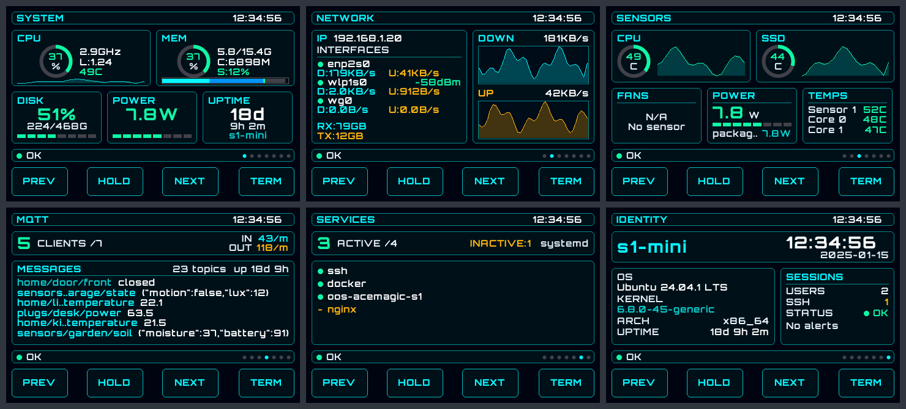
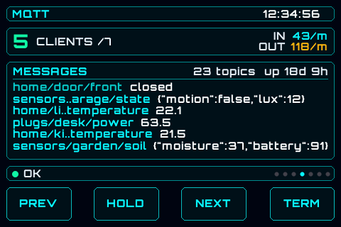

# oos-rpi-lcd35

A system dashboard for a **Raspberry Pi with a 3.5" 480x320 SPI touch display**
(ILI9486/ILI9488 panel, XPT2046 touch controller). It is the
[oos-acemagic-s1](https://github.com/IO-Nji/oos-acemagic-s1) dashboard on a different
screen: the same pages and code, drawn at 150 % with touch buttons underneath and a
look tuned for a small, low-contrast panel.



*Screenshots are rendered by the bundled preview tool from sample data.*

> **Tested on** a Raspberry Pi 3 A+ with a Waveshare 3.5" (B) v2 display
> (`fb_ili9486` framebuffer, `ADS7846` touch) on Raspberry Pi OS 12, 32-bit. Other
> 480x320 SPI displays driven by the kernel should work but have not been tried.

## What it shows

| Page | Contents |
| --- | --- |
| **System** | CPU load, frequency, load average and temperature; memory; disk; uptime |
| **Network** | address, per-interface speeds and Wi-Fi signal, totals, traffic graphs |
| **Sensors** | CPU temperature with history, other temperature sensors |
| **MQTT** | broker status and a running log of messages by topic |
| **Docker** | running containers, unhealthy first, then the busiest |
| **Services** | state of the systemd units you choose |
| **Identity** | hostname, clock, OS, kernel, uptime, login sessions and alerts |

The footer of every page shows the machine's health: `OK`, or the most serious alert,
such as `MQTT OFFLINE`, `LOW VOLTAGE` (the Pi's supply is sagging), `DISK 93%` or
`1 SVC FAILED`. The pages and alerts are described in full in the
[oos-acemagic-s1 README](https://github.com/IO-Nji/oos-acemagic-s1#readme).

Power and fan readings do not exist on a Pi and show N/A. On a Pi without Docker or
without an MQTT broker, remove `docker` or `mqtt` from `pages` in the settings file.

### MQTT page



The dashboard connects to the broker on the Pi as a read-only client; it never
publishes. The top card shows connected clients (the dashboard counts as one) and
messages in and out per minute. The log lists each message as it arrives, topic then
payload, newest at the bottom. Tap **HOLD** to stay on the page and watch.

By default it lists every topic. To narrow it, set `mqtt_topics` in the settings
file, for example `mqtt_topics = home/#, sensors/+/state`.

## Touch navigation

| Control | Action |
| --- | --- |
| **PREV** / **NEXT** | previous or next page |
| swipe left / right across the page | next or previous page |
| **HOLD** | stop automatic rotation; shows **HELD** until tapped again |
| **TERM** | hand the display to the text console; tap anywhere to return |

The console keeps its login session while the dashboard is showing, so **TERM**
brings you back to the same shell.

## Requirements

- The display must be driven by the kernel, so that it appears as a 480x320
  framebuffer (`/dev/fb1` or `/dev/fb0`) and the touch controller as an input device.
  On Raspberry Pi OS that is a `dtoverlay` line in `/boot/firmware/config.txt` for
  your display (for example `waveshare35b-v2`, `waveshare35a`, `piscreen` or
  `tft35a`), in landscape. Check with:

  ```
  cat /sys/class/graphics/fb*/name /sys/class/graphics/fb*/virtual_size
  grep -i touch /proc/bus/input/devices
  ```
- For the **TERM** button: a text console on the display (`fbcon=map:1` on the
  kernel command line when the display is `/dev/fb1`).
- For the MQTT page: a broker to watch, by default on the Pi itself, port 1883.

## Install

```
git clone --recurse-submodules https://github.com/IO-Nji/oos-rpi-lcd35.git
cd oos-rpi-lcd35
sudo ./install.sh
```

The installer installs a compiler and CMake if needed, builds and runs the tests
(about three minutes on a Pi 3), installs `/usr/local/bin/oos-rpi-lcd35`, the systemd
unit and `/etc/oos-rpi-lcd35/config.conf`, then enables and starts the service. Stop
any other program that draws on the display first.

Then calibrate the touch panel once:

```
sudo systemctl stop oos-rpi-lcd35
sudo oos-rpi-lcd35 --calibrate      # tap the three targets
```

Paste the lines it prints into `/etc/oos-rpi-lcd35/config.conf` and start the
service again with `sudo systemctl start oos-rpi-lcd35`.

To upgrade: `git pull --recurse-submodules` and run `sudo ./install.sh` again; your
settings are kept. To remove: `sudo ./uninstall.sh` (add `--purge` to delete the
settings too).

## Configure

Edit `/etc/oos-rpi-lcd35/config.conf`, then `sudo systemctl restart oos-rpi-lcd35`.
Every line is optional.

| Setting | Meaning | Default |
| --- | --- | --- |
| `page_interval` | seconds per page (2 to 3600) | `5` |
| `pages` | pages to show, in order | `system, network, sensors, mqtt, docker, services, identity` |
| `services` | systemd units on the Services page; missing ones are skipped | a list of common services |
| `disk` | filesystem shown in the DISK card | `/` |
| `mqtt_host`, `mqtt_port` | broker to watch | `127.0.0.1`, `1883` |
| `mqtt_user`, `mqtt_password` | login, if the broker needs one | none |
| `mqtt_topics` | topic filters to list, comma separated | `#` |
| `display` | framebuffer device | first 480x320 framebuffer |
| `touch` | input device | first touchscreen found |
| `console_tty` | terminal that shares the display | `/dev/tty1` |
| `console_hook` | command run when the console takes over, e.g. to set its font | none |
| `touch_swap_xy`, `touch_min_x`, `touch_max_x`, `touch_min_y`, `touch_max_y` | calibration, from `--calibrate` | driver ranges |

If you put a broker password in the file, restrict it:
`sudo chmod 600 /etc/oos-rpi-lcd35/config.conf`.

## Troubleshooting

Start with the log: `journalctl -u oos-rpi-lcd35 -n 20`.

**"Cannot open the display: no 480x320 framebuffer found".**
The display is not driven by the kernel, or is in portrait (320x480). Check the
`dtoverlay` line and its `rotate` option.

**Taps land in the wrong place, or left and right are swapped.**
Run the calibration step above.

**"Touch disabled" in the log.**
No touchscreen input device was found; the pages still rotate on their own. Check
`grep -i touch /proc/bus/input/devices`, or set `touch` in the settings file.

**TERM shows a blank screen.**
The text console is not on this display; see Requirements.

**MQTT page says "BROKER OFFLINE".**
Nothing accepted the connection at `mqtt_host`:`mqtt_port`, or the broker refused the
login. Try `mosquitto_sub -h 127.0.0.1 -t '$SYS/broker/version' -C 1` on the Pi.

**`LOW VOLTAGE` in the footer.**
The Pi's supply voltage is below the safe level right now. Use a stronger power
supply or a shorter, thicker cable.

## How it is put together

```
core/                git submodule: oos-acemagic-s1 (drawing, fonts, theme, data, pages)
src/device.hpp       display size, scale, spacing and default pages
src/ui/touch.hpp     touch calibration and gesture recognition (no hardware)
src/ui/nav_bar.hpp   the touch buttons and what each gesture does
src/hw/              framebuffer output, touch input device, console terminal
tools/preview.cpp    offline renderer
tests/               unit tests
```

- Pages are laid out in units of the S1's 320x170 panel; this display is 320 x 213 of
  those units at 150 %. A fix or a new page in the core reaches both devices.
- The look for this panel is chosen in `src/device.hpp` and `CMakeLists.txt`: no outer
  frame, one 6-unit rhythm for every margin and gap, card content centred, the
  core's high-contrast palette (near-black blue background, near-white text), and
  the 150 % font set, which is a step heavier and set wider apart.
- Only rows of the picture that changed are written to the framebuffer, since every
  write to an SPI display costs bus time. On a Pi 3 A+ the service uses about 2 % of
  one core.
- It runs as root (needed for the framebuffer, the input device and the console) with
  `NoNewPrivileges`, a read-only system and home, and a private `/tmp`.

## Development

```
cmake -S . -B build && cmake --build build
build/oos-rpi-preview --mock typical --out DIR    # render the pages to PNG
build/oos-rpi-preview --live --out DIR            # with this machine's data
```

The build runs the unit tests and a check that fails if any text overlaps, leaves the
screen, or has less than 4.5:1 contrast. It needs no Pi: everything except `src/hw`
builds and runs on a PC.

To move to a newer core: `git submodule update --remote core`, rebuild, commit.

## Licence

[GNU General Public License v3.0](LICENSE). Orbitron font: SIL Open Font License 1.1
(`core/third_party/Orbitron-OFL.txt`). Not affiliated with Raspberry Pi Ltd or
Waveshare.
